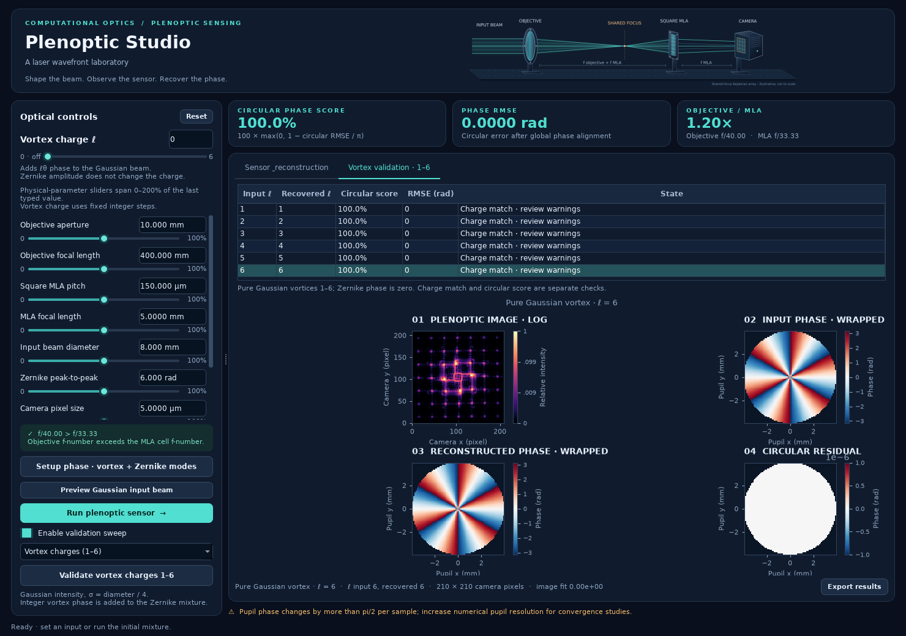
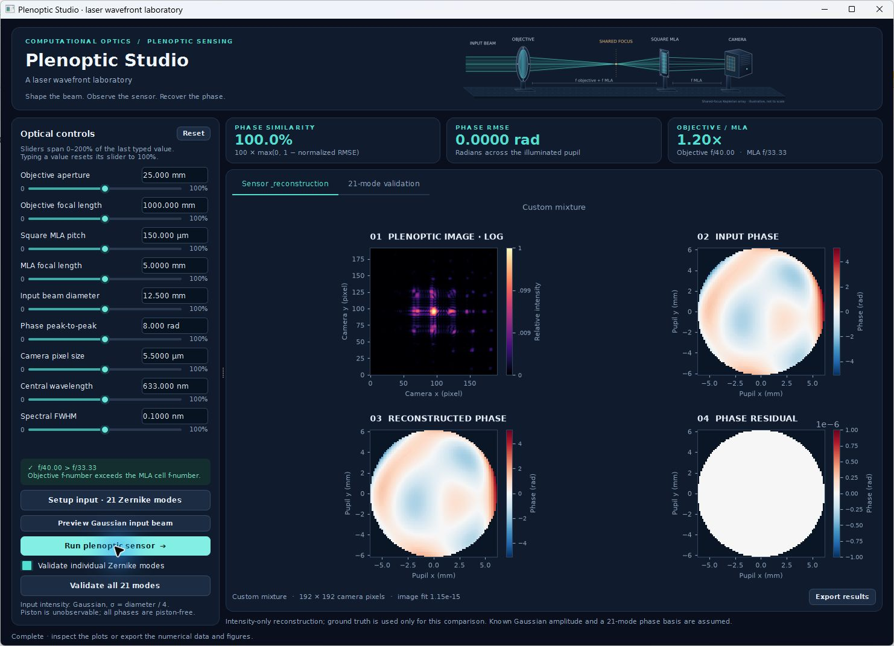
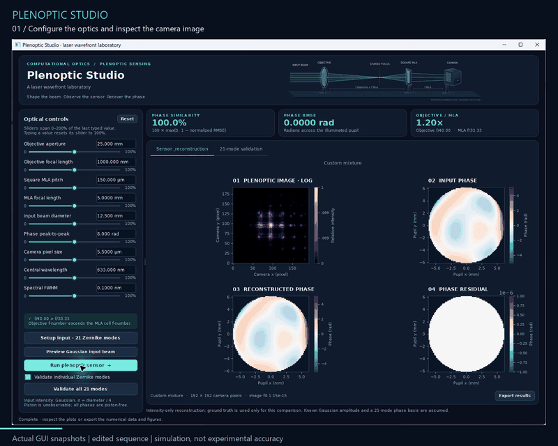
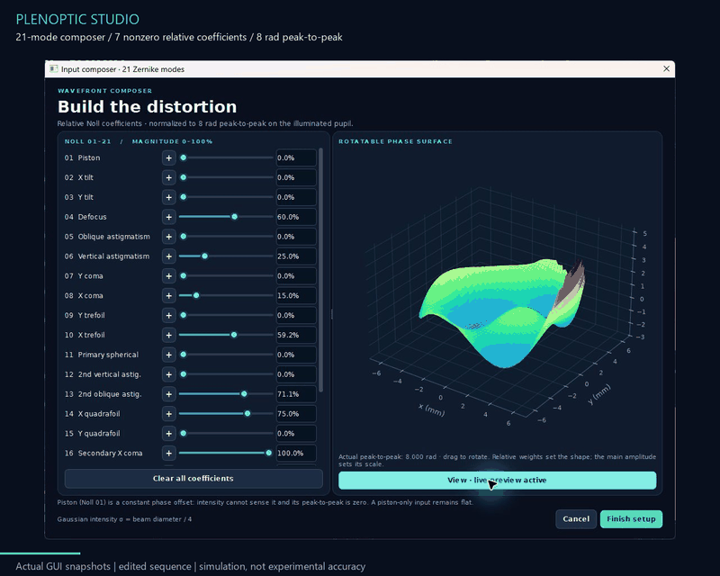
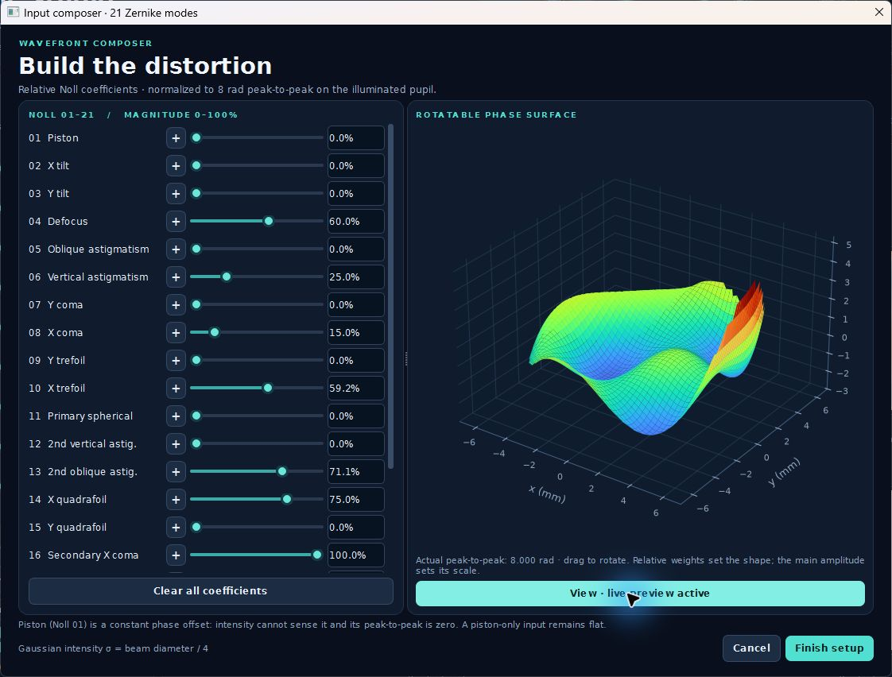
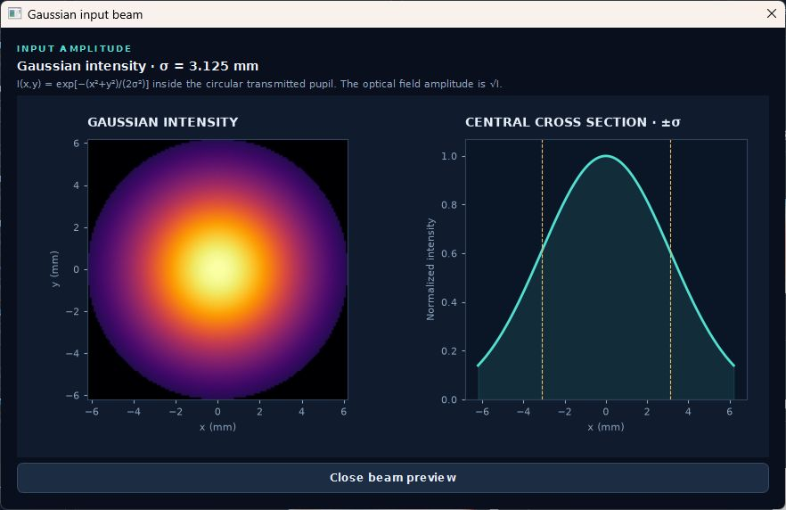
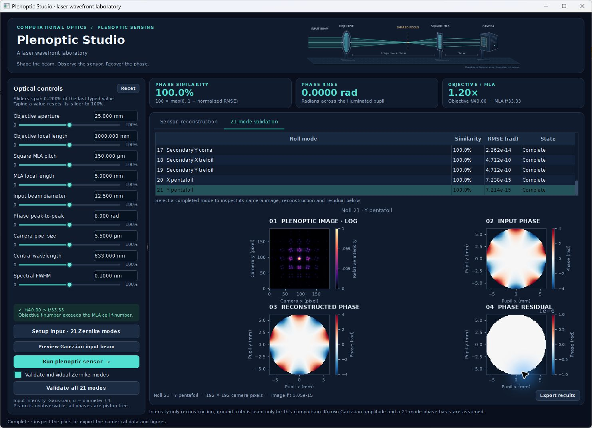
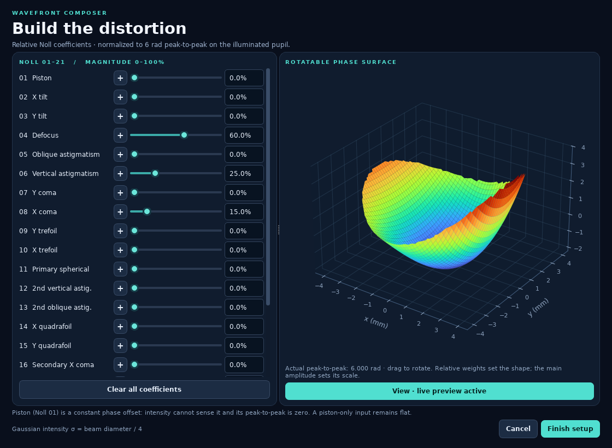
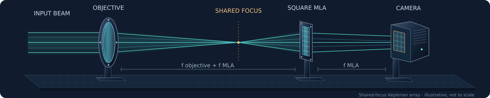

# Plenoptic Sensor in Python

**Plenoptic Studio — an interactive Python laboratory for laser wavefront sensing.** Construct a Gaussian beam with low-order Zernike distortion, propagate its coherent field through a shared-focus plenoptic sensor, and reconstruct the phase from the simulated camera image.

The input also supports an **ideal Gaussian vortex with integer topological charge 0–6**, added to the Zernike phase. The vortex extension is based on [Wu, Ko and Davis, *Optics Letters* 41, 3169–3172 (2016)](https://doi.org/10.1364/OL.41.003169). See [vortex operation, reconstruction and validation](plenoptic_studio/docs/VORTEX.md).

**Front-panel validation:** choose **Vortex charges (1–6)** to run all six pure vortices, compare generated and recovered charges, and inspect or export each reconstruction. The existing 21-mode Zernike sweep remains available.



[Quick start](#quick-start) · [GUI demos](#gui-demos) · [Prepared demo](#reproduce-the-prepared-demo) · [Model details](plenoptic_studio/docs/MODEL.md) · [Research and references](plenoptic_studio/docs/RESEARCH.md)



## GUI demos

These clips show the original Zernike workflow; the screenshot above shows the new vortex controls. They are **edited sequences of snapshots from the actual running GUI**, using the prepared configuration below. Playback is time-compressed for demonstration and is **not a continuous screen recording or a real-time performance benchmark**. Click a preview to open its MP4 file.

| Sensor workflow | Rotate the wavefront in 3D |
|---|---|
| [](docs/media/gui_walkthrough.mp4) | [](docs/media/wavefront_rotation.mp4) |
| [Open walkthrough video (MP4)](docs/media/gui_walkthrough.mp4) | [Open rotation video (MP4)](docs/media/wavefront_rotation.mp4) |

<details>
<summary>View the prepared wavefront composer</summary>



</details>

<details>
<summary>View the Gaussian input and individual-mode validation</summary>





</details>

## Quick start

Install **64-bit Python 3.10 or newer**. On Windows, enable “Add Python to PATH” during installation. Then clone the repository:

```sh
git clone https://github.com/WuUMD2018/Plenoptic-Sensor-in-Python.git
cd Plenoptic-Sensor-in-Python
```

You can also use GitHub's **Code → Download ZIP**, then extract it to a writable folder.

**Windows:** double-click `run_windows.bat`, or run it from the repository folder:

```powershell
.\run_windows.bat
```

**macOS/Linux:** run `sh run_mac_linux.sh` in the repository folder. The code is portable; the delivered version was executed and checked on Windows, not on macOS/Linux.

The launchers create a local `.venv` and install dependencies on first launch; internet access is required for that setup. For manual installation on Windows:

```powershell
python -m venv .venv
.\.venv\Scripts\python -m pip install -r requirements.txt
.\.venv\Scripts\python -m plenoptic_studio
```

Manual installation on macOS/Linux:

```sh
python3 -m venv .venv
.venv/bin/python -m pip install -r requirements.txt
.venv/bin/python -m plenoptic_studio
```

Alternatively, `python -m pip install .` installs the `plenoptic-studio` command. The interface requires PySide6 and Matplotlib. The numerical core uses NumPy and prefers SciPy; a tested NumPy solver fallback is included for restricted environments.

## Reproduce the prepared demo

The screenshots and videos above use this configuration, exported from the running GUI in [run_settings.json](docs/demo_data/run_settings.json). These demo values differ from the application's starting defaults shown in the next section.

| Parameter | Prepared demo value |
|---|---:|
| Objective diameter | 25 mm |
| Objective focal length | 1000 mm |
| Square MLA pitch | 150 µm |
| MLA focal length | 5 mm |
| Input beam diameter | 12.5 mm |
| Phase peak-to-peak | 8 rad |
| Camera pixel size | 5.5 µm |
| Central wavelength | 633 nm |
| Spectral FWHM | 0.1 nm |

The intensity sigma is **3.125 mm**, one quarter of the beam diameter. The objective is f/40 and the MLA cells are f/33.33.

Enter these **positive relative strengths** in the Zernike composer; set all unlisted modes to zero:

| Noll index | Mode | Relative strength |
|---:|---|---:|
| 4 | Defocus | 60.0% |
| 6 | Vertical astigmatism | 25.0% |
| 8 | X coma | 15.0% |
| 10 | X trefoil | 59.2% |
| 13 | Secondary oblique astigmatism | 71.1% |
| 14 | X quadrafoil | 75.0% |
| 16 | Secondary X coma | 100.0% |

The mixture is normalized together to **8 rad peak-to-peak**; these percentages are not separate phase amplitudes. The GUI displays **100.0% similarity** for this noiseless, same-model example. This demonstrates numerical self-consistency, **not experimental sensor accuracy** or robustness to calibration errors and noise.

Inspect the exported [reconstruction figure (PNG)](docs/demo_data/plenoptic_reconstruction.png), [camera and phase arrays (NPZ)](docs/demo_data/plenoptic_result.npz), and [parameters, relative weights, and solver diagnostics (JSON)](docs/demo_data/run_settings.json).

To reproduce the simulation from the repository root:

```python
import json
from pathlib import Path
from plenoptic_studio.optics import Parameters, simulate

settings = json.loads(Path("docs/demo_data/run_settings.json").read_text())
result = simulate(Parameters(**settings["parameters"]), settings["relative_weights"])
print(result.similarity_pct, result.rms_error_rad)
```

## Controls and starting values

**Vortex charge ℓ** is a separate integer slider spanning **0–6**. Zero disables the vortex. The existing phase-amplitude control scales only the smooth Zernike distortion; the vortex contributes `ℓ × atan2(y, x)` independently. For a pure vortex, set the Zernike phase amplitude to zero or clear the Zernike coefficients. The input amplitude remains Gaussian; this is a phase-imprinted beam, not a prescribed Laguerre–Gaussian intensity profile.

| Parameter | Initial value | Interpretation |
|---|---:|---|
| Objective diameter | 10 mm | Effective circular entrance-pupil aperture |
| Objective focal length | 400 mm | Ideal thin objective |
| Square MLA pitch | 150 µm | Square cell side / center spacing, unity fill factor |
| MLA focal length | 5 mm | Identical ideal microlenses |
| Input beam diameter | 8 mm | Circular phase support; intensity σ = 2 mm |
| Phase peak-to-peak | 6 rad | At the central wavelength, over the transmitted pupil |
| Camera pixel size | 5 µm | Physical detector sample spacing |
| Central wavelength | 633 nm | Reference wavelength for phase in radians |
| Spectral FWHM | 0.1 nm | Gaussian intensity spectrum; 0 means monochromatic |

Every physical-parameter slider spans **0–200% of the last explicitly entered value**. The separate vortex slider uses absolute integer charges 0–6. Moving a slider updates its numeric box. Editing a physical-parameter box, including retyping its current value, resets its reference to 100%. Zero phase and zero bandwidth are valid; zero dimensions, focal lengths, or wavelength disable computation with an explanation. If you set a reference value to zero, type a positive value again to restore a useful slider range.

The default objective is f/40 and each MLA cell is f/33.33. The interface uses a strict margin check and warns whenever `Fobjective <= FMLA`. The literature permits equality as the matched boundary; the warning explains that it has no margin.

## Use the laboratory

1. **Setup input · 21 Zernike modes** opens the phase composer. Each Noll mode has a 0–100% strength box and slider. An optional sign toggle permits negative coefficients. These are relative weights; their sum is normalized to the main peak-to-peak phase.
2. Click **View** to enable a rotatable 3D surface. Drag to rotate; changing coefficients then refreshes the surface automatically. **Finish setup** accepts the mixture and returns to the main window. Cancel discards changes.
3. **Preview Gaussian input beam** displays the actual truncated intensity profile and cross section. The intensity, rather than field amplitude, has `sigma = beam diameter / 4`.
4. **Run plenoptic sensor** displays the camera image, ground-truth phase, reconstructed phase, and residual. A background worker keeps controls responsive and allows cancellation.
5. Enable validation and choose a sweep on the front panel: **Zernike modes (21)** tests each mode separately at the requested phase range and selected vortex charge; **Vortex charges (1–6)** tests six pure Gaussian vortices with no smooth Zernike distortion, using the current optical settings. The vortex sweep overrides the input charge for each case and searches all charges 0–6 from the camera image. Select a completed row to inspect its plots and compare the input and recovered charges.
6. **Export results** saves the current run as PNG, NPZ numerical arrays, and JSON settings. In the validation tab it saves a CSV table, a multipage PDF, and one NPZ per completed case. The vortex sweep has separate filenames and per-charge settings. Partial sweeps can be exported. Existing files of the same names in the chosen folder are overwritten.



**Noll 1 is piston.** A constant phase has zero peak-to-peak and is unobservable from intensity. Piston-only input produces the flat reference, with similarity **N/A**. A zero mixture or zero main phase also has N/A normalized similarity; RMSE remains available. The convention is Noll 1–21, including piston, not 21 non-piston modes.

## Mechanism and implemented reconstruction

The design follows the **shared-focus Keplerian configuration** of Wu, Ko and Davis. The objective's rear focal plane coincides with the MLA's front focal plane. The physical objective-to-MLA spacing is `f_objective + f_MLA`; the detector is `f_MLA` behind the array. The objective separates angular content and the microlenses retain spatial information within a matrix of images. See [research notes and five primary references](plenoptic_studio/docs/RESEARCH.md).



The implementation propagates the **complex field**, not a ray-splatted image:

1. Build a circularly supported Gaussian field with the specified phase.
2. Evaluate the objective Fourier transform on a physical focal-plane grid.
3. Fresnel-propagate one MLA focal length to the physical array.
4. Apply the periodic square-cell thin-lens phase, then Fresnel-propagate one MLA focal length to the camera.
5. Sum spectral intensities using Gaussian quadrature. The optical-path distortion is fixed, so phase scales as `lambda_center / lambda`; ideal focal lengths remain constant.

Reconstruction minimizes the discrepancy between predicted and measured **square-root normalized camera intensities**, fitting Noll 2–21 with analytic image derivatives and searching integer vortex charges 0–6. Initial guesses and candidate ranking come from the camera image and a fixed set of seeds. Generating coefficients, the input charge, the true phase, and the requested phase magnitude are **not supplied as known answers to the inverse fit**. Ground truth is used only after inference to calculate errors. This is a model-based nonlinear inverse solver. A separate [gradient/curl and branch-cut LMSE diagnostic](plenoptic_studio/docs/VORTEX.md) evaluates the 2016 paper's reconstruction principle.

Similarity is explicitly

```text
100 × max(0, 1 − phase_RMSE / ground_truth_phase_RMS)
```

Both phases have piston removed on the transmitted pupil. No scale, sign, tilt, or rotation is fitted away. A reconstruction with half the correct phase amplitude scores 50%. This score is a normalized-error measure, not a correlation coefficient or confidence level.

When a vortex is present or inferred, plots use wrapped phase and the score instead becomes `100 × max(0, 1 − circular_RMSE / π)`, after removing one global phase offset. The GUI reports the inferred charge separately. Circular phase error avoids penalizing equivalent branch-cut choices; the score alone cannot establish correct topology or experimental accuracy.

## Validation, scope, and limitations

The delivered examples include a complete 21-mode sweep, individual four-panel plots, numerical data for a mixed-mode run, and a [validation gallery](plenoptic_studio/examples/validation_gallery.png). The default low-order, noiseless examples reconstruct very closely because generation and inference use the same model. **Near-100% similarity demonstrates numerical consistency, not physical instrument accuracy.** Independent pupil-grid and propagation-window tests are also included.

Important modeling choices:

- Scalar, paraxial, ideal achromatic thin lenses; perfectly aligned, square, unity-fill MLA; known Gaussian amplitude; no photon noise, read noise, quantization, camera saturation, or lens aberrations.
- An effective circular **entrance-pupil stop** represents objective diameter. Separate propagation to a physical objective stop and distortion-dependent vignetting there are not modeled.
- The Gaussian is explicitly truncated at half the beam diameter; this is not an unbounded Gaussian.
- Default pupil sampling is 80 × 80. The camera covers approximately seven pitches, subject to a minimum grid size and a 384-pixel computational cap. A smaller pixel can reduce the field of view when that cap is reached.
- FFT Fresnel propagation has a finite periodic window. Pixel flux is midpoint area quadrature, not exact subpixel integration. Refinement is necessary before quantitative optical design; edge-energy and sampling diagnostics cannot prove convergence.
- Spectral integration uses three or five wavelengths. Very broad spectra are approximate and produce a warning; FWHM greater than half the central wavelength is rejected by this model.
- Fitting assumes the lowest 20 observable Zernike modes plus one centered ideal vortex with nonnegative integer charge 0–6. Displaced or multiple vortices, negative charges, unknown amplitude/scintillation, arbitrary high-order turbulence, or miscalibration need a richer inverse model.
- Nonlinear phase retrieval can converge to a local minimum, especially at higher phase excursions. A converged optimizer or a low image residual does not prove a unique solution. The app reports residuals, conditioning, clipping, and convergence warnings.

Detailed equations, numerical assumptions and diagnostics are in [MODEL.md](plenoptic_studio/docs/MODEL.md). Original paper algorithms and experimental results are described separately in the research notes.

## Reproduce and extend

```sh
# From the project root, using the same Python as the GUI:
python -m unittest discover -s plenoptic_studio/tests -v
python -m plenoptic_studio.demo --output example_output
python -m plenoptic_studio.demo --output example_output --validate
python -m plenoptic_studio.demo --output vortex_example --vortex-charge 4
python -m plenoptic_studio.vortex_validation --output vortex_results --refinement
```

For predictable performance, use `OPENBLAS_NUM_THREADS=1` and `OMP_NUM_THREADS=1`; the supplied launchers set these. Charge search can require multiple nonlinear fits. Full validation and grid-refinement comparisons can take several minutes, depending on the machine, spectrum, geometry, and solver convergence. Progress and cancellation remain available in the GUI.

The public numerical API is independent of Qt:

```python
import numpy as np
from plenoptic_studio.optics import Parameters, OpticalModel, simulate

parameters = Parameters(phase_ptp_rad=6.0, bandwidth_nm=0.0)
weights = np.zeros(21)
weights[3], weights[4], weights[7] = 1.0, 0.25, 0.2
result = simulate(parameters, weights)
print(result.similarity_pct, result.rms_error_rad)

# Explicit image-only reconstruction; image must match this calibrated model grid.
model = OpticalModel(parameters, pupil_resolution=160, camera_min=384)
camera_image = model.forward(result.wavefront.coefficients)
phase, coefficients, diagnostics = model.reconstruct(camera_image)
```

Changing resolution can change sampled peak-to-peak extrema. Preserve the same physical coefficients, not independently renormalized sample arrays, when comparing grids.

```text
plenoptic_studio/
    optics.py          coherent propagation and inverse solver
    gui.py             controls, composer, threaded workflow, exports
    demo.py            headless example generation
    assets/            original optical bench illustration
    docs/              research, model details, screenshots, validation evidence
    examples/          generated simulations and 21-mode gallery
    tests/             numerical and GUI interaction regressions
```

If startup reports a missing module, install `requirements.txt` using the same interpreter used to launch the app. On headless machines, use `demo.py` or set `QT_QPA_PLATFORM=offscreen` for tests. Offscreen screenshots are included as interface previews; the application itself is a native desktop window.

## License

This project is available under the [MIT License](LICENSE).
