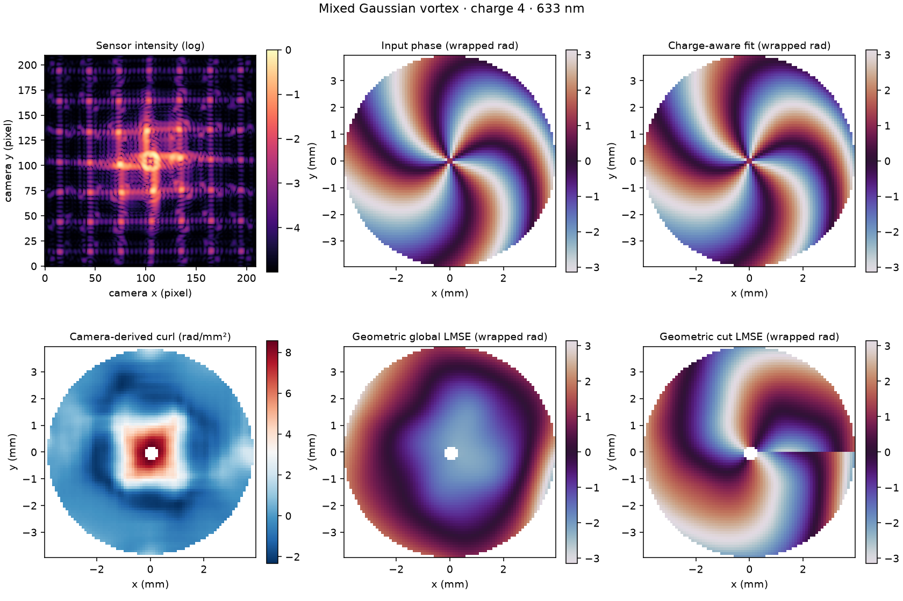
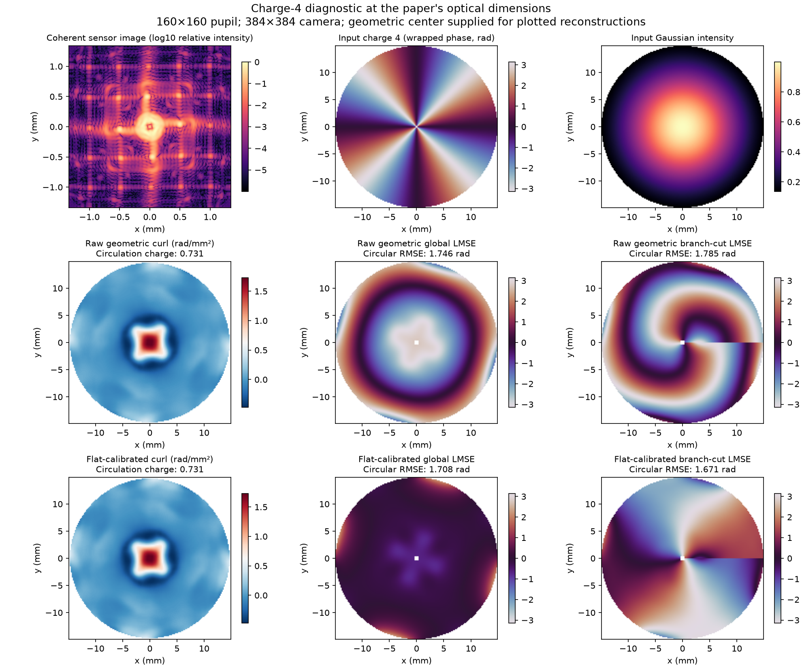

# Gaussian vortex phase and plenoptic reconstruction

## Use the GUI

Set **Vortex charge ℓ** to an integer from 0 to 6, then run the sensor. Charge 0 reproduces a Gaussian beam with the existing Zernike distortion. Nonzero charge adds a helical phase to the same Gaussian amplitude. The composer previews the combined phase. Clear its Zernike coefficients, or set the Zernike phase amplitude to zero, for a pure vortex.

The phase-amplitude slider scales only the Zernike component. It never scales the topological charge. Reset restores charge 0. Exports preserve both the input and recovered charge, numerical phase arrays, and the metric definition.

## Beam convention

At the reference wavelength,

```text
E(x,y) = sqrt(I_Gaussian(x,y)) exp{i [phi_Zernike(x,y) + ℓ atan2(y,x)]}
I_Gaussian = exp[-(x²+y²)/(2σ²)],  σ = beam diameter / 4
```

The circular entrance-pupil support is unchanged. The singular center has undefined phase and is excluded when sampled. Away from it the entrance intensity remains Gaussian; a dark ring is not imposed as a Laguerre–Gaussian radial profile. Diffraction is calculated by the existing coherent propagation model.

For broadband simulation the ideal azimuthal factor `exp(iℓθ)` is achromatic, while the Zernike optical-path distortion scales as `λ_center/λ`. This preserves integer winding at each wavelength. A dispersive physical phase plate, its thickness steps, scattering and the paper's beam-expansion/free-space path are not modeled.

## What reconstruction knows

The coherent inverse searches the fixed candidate set `{0,1,2,3,4,5,6}`. For each candidate it fits the 20 observable Zernike coefficients to the camera image. Candidate order and initial coefficients are chosen from camera residuals, not phase truth. A strict near-zero camera residual permits an early stop in the noiseless case; it does not prove uniqueness. Otherwise the candidate fits are compared using their camera residuals.

The validation script constructs the inverse model with charge 0 even when the independently generated image has another charge. This checks that the input slider is not silently passed to reconstruction as the correct answer. The Gaussian amplitude and optical calibration are assumed known.

For a vortex the phase maps and residual are circular quantities. The reported circular RMSE removes one global phase offset and takes the principal phase difference in `[-π,π]`. Its display score is `100 max(0,1−RMSE/π)`. Recovered integer charge is reported separately. Ordinary unwrapped, piston-aligned RMSE and its original normalized score are retained for charge-zero input and reconstruction.

## Relationship to the paper

Reference: Chensheng Wu, Jonathan Ko and Christopher C. Davis, [“Using a plenoptic sensor to reconstruct vortex phase structures,” *Optics Letters* 41, 3169–3172 (2016)](https://doi.org/10.1364/OL.41.003169).

The paper maps illuminated camera pixels to input-plane coordinates and gradients, smooths the dense gradient field, locates a branch point from its curl, inserts branch cuts, then applies least-mean-square gradient integration within the resulting regions. It compares this with global LMSE that ignores the branch point. Its experiment uses a charge-4 physical phase plate at 633 nm. The central region is excluded from its reported phase-jump measurements because the large gradients lose information.

`vortex_diagnostics.py` implements a **paper-inspired geometric diagnostic**: intensity-weighted mapping using Eqs. (2)–(4), masked 3×3 Gaussian smoothing, curl and circulation, then sparse global LMSE versus LMSE with one radial cut. One arbitrary cut is sufficient to represent a single vortex's continuous phase over the cut domain; its placement is a phase convention. This does not claim to recover the physical plate's four scattering ridges. Optional flat-reference subtraction is an explicitly labeled calibration variant, additional to the direct mapping.

The main GUI reconstruction is the coherent camera fit, which is a different inverse method. Comparing it with the geometric diagnostic separates the benefit of adding a vortex basis from the effectiveness of the paper's gradient-integration principle under this simulator's sampling and diffraction assumptions.

The paper's hardware uses a 30 mm / 3000 mm objective, 500 µm / 46.7 mm microlenses, 7 µm camera pixels and a 20×20 MLA. The validation below uses the application's default geometry at monochromatic 633 nm. The finite simulation window and 384-pixel cap do not reproduce that full hardware. No experimental accuracy claim is made.

## Reproduce the evaluation

```sh
python -m unittest discover -s plenoptic_studio/tests -v
python -m plenoptic_studio.vortex_validation --output vortex_results --refinement
python -m plenoptic_studio.paper_geometry_validation --output vortex_results
```

The sweep tests pure and mixed Zernike/vortex inputs at every integer charge 0–6, compares a smooth-only inverse, and saves camera-derived gradient/curl/LMSE results. It also supports an independent pupil-grid check that preserves physical coefficients while generating on 120 samples and reconstructing on 80 samples. JSON/CSV metrics and NPZ arrays make both successes and failures inspectable. Geometric-method metrics exclude its unsupported central/masked samples, so they must not be treated as measurements over exactly the same pupil as the coherent fit.

## Numerical results, 2026-11-16

**All 37 automated tests passed** on Windows/Python 3.13.2, with NumPy 2.5.5, SciPy 1.18.1, Matplotlib 3.11.2 and PySide6 6.12.0. Native GUI testing confirmed that the integer slider, combined-phase run and inferred-charge display work. The analytic-gradient tests verify that introducing a cut recovers a vortex that global LMSE cannot represent.

The independent camera-image sweep recovered the correct integer charge in **14/14 cases**: seven pure vortices and seven mixed inputs. Mixed inputs use the default defocus/vertical-astigmatism/X-coma weights 0.60/0.25/0.15, normalized to 6 rad smooth phase. The table below shows the mixed cases; all pure cases also recovered the correct charge.

| Input charge | Coherent fit charge | Coherent circular RMSE (rad) | Geometric circulation estimate | Cut-LMSE circular RMSE (rad) |
|---:|---:|---:|---:|---:|
| 0 | 0 | 1.57e-13 | 0.00 | 0.58 |
| 1 | 1 | 1.38e-12 | 0.06 | 1.70 |
| 2 | 2 | 3.74e-15 | 0.36 | 1.60 |
| 3 | 3 | 6.26e-16 | 0.99 | 1.57 |
| 4 | 4 | 7.89e-11 | 3.17 | 1.52 |
| 5 | 5 | 8.62e-16 | 5.12 | 1.56 |
| 6 | 6 | 2.76e-10 | 7.05 | 1.79 |

These very small coherent-fit errors are **same-model noiseless consistency**, not experimental precision. The charge-4 independent-grid check (120-sample generator, 80-sample inverse, identical physical coefficients) still recovered charge 4, with circular RMSE **0.000687 rad** and square-root intensity discrepancy **0.0131**. This is one grid-mismatch check, not convergence over all settings. The smooth-only charge-zero inverse had circular RMSE about 1.53 rad on the mixed charge-4 image.



**The geometric diagnostic does not establish accurate vortex reconstruction from these synthetic camera images.** On charge 4, a cut improves the mixed-case circular RMSE from about 1.81 to 1.52 rad, but substantial error remains. Across charges the circulation can be too small or too large, and a cut does not consistently improve the phase error. Low gradient-fit residual is not sufficient evidence of correct optical phase.

A second check used the paper's listed optical dimensions at charge 4, with a 160×160 pupil. The simulation's camera was capped at 384×384 pixels (5.376 lenslet pitches, rather than the paper's 20×20 MLA). Direct mapping with a detected center estimated charge **0.761**, with global/cut circular RMSE **1.746/1.785 rad**. Flat-reference calibration changed the cut RMSE to **1.666 rad** but did not fix charge recovery. Supplying the known geometric center also did not fix it. Small outer-camera energy (0.032%) alone therefore does not validate this reconstruction.



The integration principle works on analytically known vortex gradients, while the camera-to-gradient approximation is not quantitatively reliable in these tested coherent images. Reproducing the paper's result would require validating the camera mapping, acquisition window, propagated amplitude and physical phase-plate effects against independent measured or more complete synthetic data. The current evidence supports the **new charge-aware coherent fit within its stated basis**, and does **not** verify the published experimental reconstruction accuracy.

Full evidence: [sweep CSV](../../docs/vortex_validation/summary.csv), [sweep and grid-check JSON](../../docs/vortex_validation/results.json), [paper-dimension JSON](../../docs/vortex_validation/paper_geometry_results.json). The commands above regenerate the numerical arrays and figures, including unfavorable cases.
